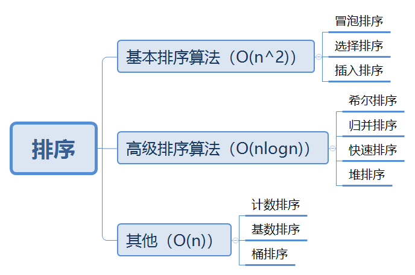
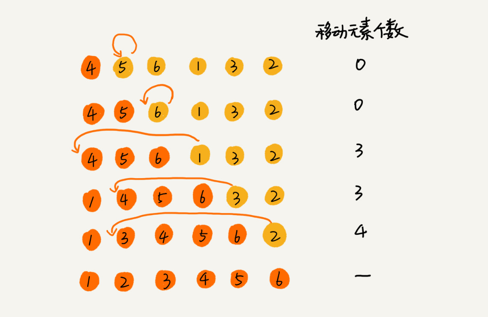
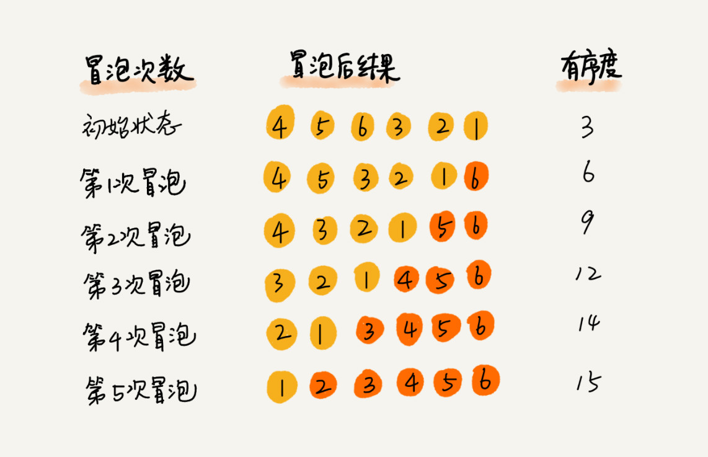
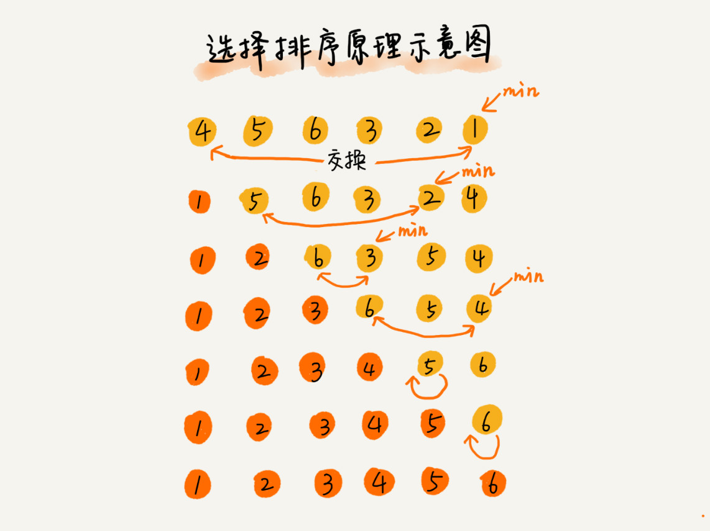

## 1. 学习顺序与比较标准

第一轮只学插入排序、归并排序与快速排序。目标不是背十份代码，而是能够回答：已经排好的部分在哪里？下一步为什么不会破坏它？时间与额外空间花在哪里？先会数组扫描，再读本文；递归不熟时，归并和快速排序可以等到学习路线的递归阶段。



本文示例默认输入为有限数值数组，按升序排序；计数与基数排序额外要求整数，具体条件见对应章节。它们是满足题目契约的教学函数，不是接收任意外部输入的通用排序库。每个代码块可以单独运行。

### 1.1 空间与原地修改

“修改原数组”与“辅助空间为 `O(1)`”不是一回事。本文把严格原地排序定义为只需要常数级辅助空间，允许使用临时变量。归并即使写回原数组，也需要合并缓冲区；快速排序即使原地分区，也要计入递归栈。

### 1.2 稳定性

相同排序键的元素，排序后相对次序保持不变，才叫稳定。数字重复值看不出身份变化，可给记录附加编号进行手推。

例如订单先按时间排序，再用稳定算法按金额排序，就能保留同金额订单原来的时间顺序。能否稳定取决于具体实现，不能只看算法名称。

### 1.3 有序度与逆序对

只考虑 `i < j`：若 `a[i] > a[j]`，这一对是逆序对；若用 `a[i] <= a[j]` 定义有序对，两者之和为 `n(n - 1) / 2`。这里明确把相等值计入有序对，避免重复元素造成漏计。插入排序的移动次数与逆序对数量有关，因此已有序或近乎有序时通常比较省事。

## 2. 主线一：插入排序，维护有序前缀

处理下标 `i` 前，`[0, i)` 已经有序。暂存 `arr[i]`，把左侧比它大的元素向右移动，再填入空位。相等时不移动，因此稳定。

```js
function insertSort(arr) {
    for (let i = 1; i < arr.length; i++) {
        const value = arr[i];
        let j = i;
        while (j > 0 && arr[j - 1] > value) {
            arr[j] = arr[j - 1];
            j--;
        }
        arr[j] = value;
    }
    return arr;
}
```



已有序时每次只需比较一次，最好时间为 `O(n)`；逆序时移动次数为 `1 + 2 + … + (n - 1)`，最坏为 `O(n²)`。随机排列下平均为 `O(n²)`；辅助空间为 `O(1)`，修改并返回原数组。

**手推任务**：处理 `[4, 2, 2, 1]` 中第二个 `2` 时，为什么不能把循环条件改为“大于等于”？给两个 `2` 标上不同身份，再观察顺序。

## 3. 主线二：归并排序，合并两个有序区间

递归返回“输入数组排序后的新数组”。长度不足 `2` 时直接复制返回；否则先排好左右两半，再比较两边尚未取出的第一个元素。每次取较小者，相等时优先取左侧，保证稳定。

```js
function mergeSort(arr) {
    if (arr.length < 2) return arr.slice();
    const mid = Math.floor(arr.length / 2);
    const left = mergeSort(arr.slice(0, mid));
    const right = mergeSort(arr.slice(mid));
    const result = [];
    let i = 0;
    let j = 0;
    while (i < left.length && j < right.length) {
        if (left[i] <= right[j]) result.push(left[i++]);
        else result.push(right[j++]);
    }
    while (i < left.length) result.push(left[i++]);
    while (j < right.length) result.push(right[j++]);
    return result;
}
```

每层合并总成本为 `O(n)`，层数为 `O(log n)`，所以最好、平均、最坏时间均为 `O(n log n)`。此实现不修改输入；同时存活的数组规模为 `O(n)`，另有 `O(log n)` 递归栈，总辅助空间为 `O(n)`。所有递归调用累计分配量可以达到 `O(n log n)`，不要与峰值辅助空间混淆。

**手推任务**：合并 `[1, 4]` 与 `[2, 3, 5]`。一个数组先取完后，为什么可以直接追加另一个数组剩余部分？

原笔记的迭代归并示例使用未声明变量、哨兵以及不稳定的等值选择；这里改为边界显式的递归实现，先理解合并，再选学自底向上的迭代版本。

## 4. 主线三：快速排序，先分区再递归

本例固定选末尾值为基准。扫描时维护三个部分：`[left, next)` 小于基准，`[next, i)` 大于等于基准，`[i, right)` 尚未检查。扫描结束把基准交换到 `next`，其位置确定，再处理两边。

```js
function quickSort(arr) {
    function sort(left, right) {
        if (left >= right) return;
        // shortcut: 固定末尾基准会退化，大输入时升级基准选择与分区策略。
        const pivot = arr[right];
        let next = left;
        for (let i = left; i < right; i++) {
            if (arr[i] < pivot) {
                [arr[next], arr[i]] = [arr[i], arr[next]];
                next++;
            }
        }
        [arr[next], arr[right]] = [arr[right], arr[next]];
        sort(left, next - 1);
        sort(next + 1, right);
    }
    sort(0, arr.length - 1);
    return arr;
}
```

本实现修改并返回原数组，分区辅助空间为 `O(1)`，但递归栈平衡时为 `O(log n)`，最坏为 `O(n)`。随机排列下平均时间为 `O(n log n)`；有序、逆序或全相等输入会使本例严重失衡，最坏时间为 `O(n²)`，大输入还可能超过调用栈限制。它适合小规模学习；实际需要大数据处理时，应改进基准选择、重复元素分区和递归深度控制，或使用适合业务的库实现。

原例通过额外左右数组再拼接，容易把空间开销藏起来；现在显式展示原地分区。快速排序本实现不稳定：例如带身份的 `[2甲, 2乙, 1]`，首次交换就改变两个 `2` 的相对顺序。

**与归并比较**：归并先递归后合并，快排先分区后递归。本例不是尾递归，因为递归调用后仍可能有另一个调用。尾调用是直接返回另一函数的调用结果；是否消除调用栈取决于运行环境，不能凭写法宣称空间为常数。原笔记有错误的阶乘示例，此处用概念说明替代，避免排序章节混入未经验证的递归代码。

## 5. 选学：其他比较排序

### 5.1 冒泡排序

相邻逆序就交换，一轮将最大值推到未排序区间末端。若整轮没有交换，则已经有序。这里只在严格大于时交换，因此稳定。最好时间为 `O(n)`，平均和最坏为 `O(n²)`，辅助空间为 `O(1)`。

```js
function bubbleSort(arr) {
    for (let end = arr.length - 1; end > 0; end--) {
        let changed = false;
        for (let i = 0; i < end; i++) {
            if (arr[i] > arr[i + 1]) {
                [arr[i], arr[i + 1]] = [arr[i + 1], arr[i]];
                changed = true;
            }
        }
        if (!changed) break;
    }
    return arr;
}
```



### 5.2 选择排序

从未排序部分选择最小值，交换到当前位置。比较次数始终为二次量级，交换次数为线性量级。辅助空间为 `O(1)`，不稳定；`[2甲, 2乙, 1]` 是反例。插入、冒泡与选择没有对所有输入都成立的性能排名。

```js
function selectSort(arr) {
    for (let i = 0; i < arr.length - 1; i++) {
        let min = i;
        for (let j = i + 1; j < arr.length; j++) {
            if (arr[j] < arr[min]) min = j;
        }
        [arr[i], arr[min]] = [arr[min], arr[i]];
    }
    return arr;
}
```



### 5.3 希尔排序

先按较大间隔做插入排序，再缩小间隔到 `1`。它不稳定，辅助空间为 `O(1)`；复杂度取决于间隔序列，不能统一写成 `O(n log n)` 或 `O(n^1.5)`。下面使用折半间隔，最坏时间为 `O(n²)`。

```js
function shellSort(arr) {
    for (let gap = Math.floor(arr.length / 2); gap > 0; gap = Math.floor(gap / 2)) {
        for (let i = gap; i < arr.length; i++) {
            const value = arr[i];
            let j = i;
            while (j >= gap && arr[j - gap] > value) {
                arr[j] = arr[j - gap];
                j -= gap;
            }
            arr[j] = value;
        }
    }
    return arr;
}
```

### 5.4 堆排序

先建大顶堆，最大值在根部；把根与末尾交换，缩小堆的范围，只调整新的根。不是每次都重新建整棵堆。自底向上建堆为 `O(n)`，整体最坏为 `O(n log n)`，本实现辅助空间为 `O(1)`，不稳定。堆的细节见[堆专题](./数据结构之堆.md)。

```js
function heapSort(arr) {
    function siftDown(root, size) {
        while (root * 2 + 1 < size) {
            let child = root * 2 + 1;
            if (child + 1 < size && arr[child + 1] > arr[child]) child++;
            if (arr[root] >= arr[child]) break;
            [arr[root], arr[child]] = [arr[child], arr[root]];
            root = child;
        }
    }
    for (let i = Math.floor(arr.length / 2) - 1; i >= 0; i--) siftDown(i, arr.length);
    for (let end = arr.length - 1; end > 0; end--) {
        [arr[0], arr[end]] = [arr[end], arr[0]];
        siftDown(0, end);
    }
    return arr;
}
```

## 6. 选学：依赖数据条件的排序

### 6.1 计数排序

对整数的每个可能值计数，再按数值顺序输出。令 `k = max - min + 1`，时间为 `O(n + k)`，不是无条件的 `O(n)`。本例返回新数组，包含结果的额外空间为 `O(n + k)`；只适合范围较小的安全整数。

```js
function countSort(arr) {
    if (arr.length === 0) return [];
    let min = arr[0];
    let max = arr[0];
    for (const value of arr) {
        min = Math.min(min, value);
        max = Math.max(max, value);
    }
    const counts = new Array(max - min + 1).fill(0);
    for (const value of arr) counts[value - min]++;
    const result = [];
    for (let i = 0; i < counts.length; i++) {
        for (let count = 0; count < counts[i]; count++) result.push(i + min);
    }
    return result;
}
```

此例只输出数值，不能用它证明对象记录的稳定性。稳定的记录版通常需要累计位置并按适当顺序回填。

原笔记使用对象键顺序作为另一实现，但负数、小数等键并不遵循“所有数值都自动升序”的规则，且 `Object.keys()` 返回字符串，也不包含 `Symbol`。因此删除该错误捷径，保留上面显式计数的实现。

### 6.2 基数排序

按个位、十位等逐轮分桶，每轮保持原相对顺序，低位的排序结果才能在高位相同时保留。本例只支持非负安全整数，基数固定为 `10`；位数为 `d` 时，时间为 `O(d(n + 10))`，辅助空间为 `O(n + 10)`。它修改原数组，但不属于常数空间排序。

```js
function radixSort(arr) {
    let max = 0;
    for (const value of arr) max = Math.max(max, value);
    for (let place = 1; place <= max; place *= 10) {
        const buckets = Array.from({ length: 10 }, () => []);
        for (const value of arr) {
            const digit = Math.floor(value / place) % 10;
            buckets[digit].push(value);
        }
        let index = 0;
        for (const bucket of buckets) {
            for (const value of bucket) arr[index++] = value;
        }
    }
    return arr;
}
```

不能用 `while (value = queue.shift())` 读取桶：取到数值 `0` 就会错误停止。本例直接遍历，避免这个错误以及反复从数组头部删除元素的开销。

### 6.3 桶排序

把数值映射到有序的区间桶，在桶内排序，再依次合并。下面保留桶宽参数，并要求它为正的有限数值；输入需保证桶数在可分配范围内。全部相等时也需要一个桶。

```js
function bucketSort(arr, bucketSize = 5) {
    if (!Number.isFinite(bucketSize) || bucketSize <= 0) {
        throw new RangeError('bucketSize must be a positive finite number');
    }
    if (arr.length === 0) return [];
    let min = arr[0];
    let max = arr[0];
    for (const value of arr) {
        min = Math.min(min, value);
        max = Math.max(max, value);
    }
    const bucketCount = Math.floor((max - min) / bucketSize) + 1;
    const buckets = Array.from({ length: bucketCount }, () => []);
    for (const value of arr) buckets[Math.floor((value - min) / bucketSize)].push(value);
    const result = [];
    for (const bucket of buckets) {
        for (let i = 1; i < bucket.length; i++) {
            const value = bucket[i];
            let j = i;
            while (j > 0 && bucket[j - 1] > value) {
                bucket[j] = bucket[j - 1];
                j--;
            }
            bucket[j] = value;
        }
        for (const value of bucket) result.push(value);
    }
    return result;
}
```

设桶数为 `b`，每个桶的元素数为 `nᵢ`。本例桶内用插入排序，总时间上界为 `O(n + b + Σnᵢ²)`，额外空间为 `O(n + b)`，不修改输入。只有分布适当、桶数合理时才可能接近线性；数据集中到少数桶时可能退化为二次时间，桶数过大则浪费内存。不能单靠增加桶数保证更快。

## 7. 对照、验证与复习

### 7.1 先掌握三种方法的差别

| 本文实现 | 时间 | 辅助空间 | 修改输入 | 稳定 |
| --- | --- | --- | --- | --- |
| 插入 | 最好 `O(n)`，平均/最坏 `O(n²)` | `O(1)` | 是 | 是 |
| 归并 | `O(n log n)` | `O(n)` | 否 | 是 |
| 快速 | 随机排列下平均 `O(n log n)`，最坏 `O(n²)` | 平均 `O(log n)`，最坏 `O(n)` | 是 | 否 |

归并的稳定性依赖于等值先取左侧；快速排序的平均复杂度需要输入分布或随机化假设，不能把平均值当保证。

### 7.2 每份实现都做边界验证

测试空数组、单元素、已排序、逆序、全相等、重复值；允许负数或小数的算法再增加对应输入。排序后必须同时满足“升序”和“元素及其次数不变”，只检查有序可能漏掉丢元素的错误。

仓库测试直接提取本文代码块执行。运行：

```sh
node --test tests/algorithm-sorting-examples.test.mjs
```

计数排序只测试范围小的安全整数，基数排序测试非负安全整数；不能把它们当成通用数值排序。本文未对旧图片中每个结论逐一校正，以正文契约和测试为准。

### 7.3 闭卷追问

1. 为什么插入排序处理一个新元素后，有序前缀长度能增加？
2. 归并时相等值先取右边，会改变哪一种性质？
3. 快排面对全相等数组为什么会退化？
4. 想排序少量数值但范围极大时，为什么不应选计数排序？

## 8. 历史参考

以下保留原笔记来源，链接和原文未在本轮重新核验：

- [图文详解堆排序算法及代码实现](https://www.jb51.net/article/83529.htm)
- [堆排序实现](https://www.cnblogs.com/helloMySir/p/8057701.html)
- 《大话数据结构》
- 《数据结构与算法 `JavaScript` 描述》
- [桶排序、计数排序、基数排序](https://juejin.im/post/5d3da990f265da1ba84ada22#heading-1)
