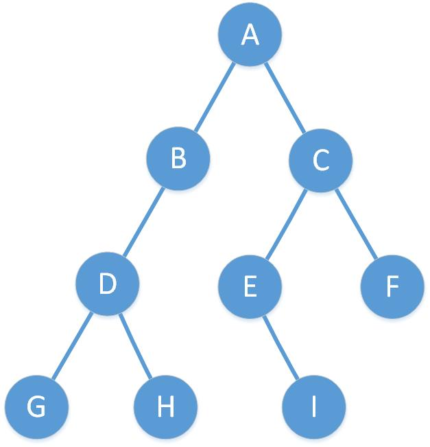

## 1. 先认识结构，再写递归

树表达父子层级：菜单、目录、组织关系都可建模为树。节点的度是孩子数量，度为零的是叶子；森林是多棵互不相交的树。这里讨论有限、无环、没有共享子节点的有根树。

本系列统一：根所在层为 `1`，空树高度为 `0`，树高按最长根到叶路径的**节点数**计算；路径长度通常按边数计算。不要把两种单位混用。

## 2. 二叉树、完全树与搜索树

二叉树最多有两个孩子，且左右有别。只有右孩子与只有左孩子不是同一结构。

| 名称 | 条件 | 注意 |
| --- | --- | --- |
| 斜树 | 每层只有一个节点 | 高度可能达到节点数 |
| 满二叉树（本文采用国内教材常见定义） | 所有非叶子有两个孩子，叶子同层 | 对应 `perfect binary tree`；不要与仅要求零或两个孩子的 `full binary tree` 混淆 |
| 完全二叉树 | 最后一层之前全满，最后一层从左连续排列 | 堆使用此结构 |
| 二叉搜索树 | 左子树所有值小于根，右子树所有值大于根 | 本文不允许重复键；结构不必平衡 |
| 高度平衡二叉树 | 每个节点左右子树高度差至多为 `1` | 比较高度，不是节点数 |

第 `i` 层至多有 `2^(i-1)` 个节点；高度为 `h` 时至多有 `2^h - 1` 个节点。非空二叉树若叶子数为 `n₀`、双孩子节点数为 `n₂`，则 `n₀ = n₂ + 1`：总边数既是 `n - 1`，也是所有节点孩子数之和。

完全二叉树使用从零开始的数组下标时，节点 `i` 的左右孩子下标为 `2i + 1`、`2i + 2`，非根节点的父下标为 `floor((i - 1) / 2)`。这套公式不能直接套到省略空位置的紧凑层序数组。

## 3. 从层序输入创建测试树

约定数组按队列顺序给每个实际节点分配左右孩子，`null` 表示缺失，可省略末尾空位置。数值 `0` 是正常节点，不能靠真假值判断存在。函数不修改输入；无法连接到根的非空值会报错。

```js
function createTree(values) {
    if (values.length === 0) return null;
    if (values[0] === null) {
        if (values.some(value => value !== null)) throw new RangeError('Unreachable node');
        return null;
    }
    const root = { val: values[0], left: null, right: null };
    const queue = [root];
    let next = 1;
    for (let head = 0; head < queue.length && next < values.length; head++) {
        for (const side of ['left', 'right']) {
            if (next >= values.length) break;
            const value = values[next++];
            if (value !== null) {
                const child = { val: value, left: null, right: null };
                queue[head][side] = child;
                queue.push(child);
            }
        }
    }
    if (values.slice(next).some(value => value !== null)) throw new RangeError('Unreachable node');
    return root;
}
```

输入为数值或 `null` 组成的数组。时间为 `O(n)`，结果与辅助队列空间均为 `O(n)`；例如 `[0, null, 2, 1]` 表示根零的右孩子是二，其左孩子是一。

## 4. 遍历顺序表达处理时机

- 前序：根、左、右，适合向下传递路径信息。
- 中序：左、根、右，搜索树中得到递增顺序。
- 后序：左、右、根，适合汇总子树返回值。
- 层序：使用队列一层层处理，适合最浅路径与层统计。



先手画一棵左右不对称的小树，再分别写四种顺序。实现与比较统一放在[遍历方法](./遍历之深度优先遍历和广度优先遍历的区别.md)，题型放在[树专题](./leetcode之树专题.md)。

## 5. 扩展结构如何理解

一般树可用“左孩子、右兄弟”表示为二叉结构：左引用指第一个孩子，右引用指下一个兄弟。森林可以把各树根按兄弟链连接。反向恢复时左引用展开为孩子列表、右引用继续找兄弟；此时右引用不是原树的孩子，不能直接沿用原树深度语义。

哈夫曼树用于前缀编码。带权路径长度是**各叶子权重乘根到叶的边数之和**；反复合并最小的两个权重得到一棵最优前缀编码树。相同权重时可能有不同的最优形状，左右编码互换也不影响长度。它与二叉搜索树的数值排序没有关系。

## 6. 验收

解释零节点为什么必须保留；画出“完全但不满”与“搜索树但不平衡”的例子；用 `createTree` 构造空树、单节点、单侧链并验证结构。

```sh
node --test tests/algorithm-tree-graph-examples.test.mjs
```
