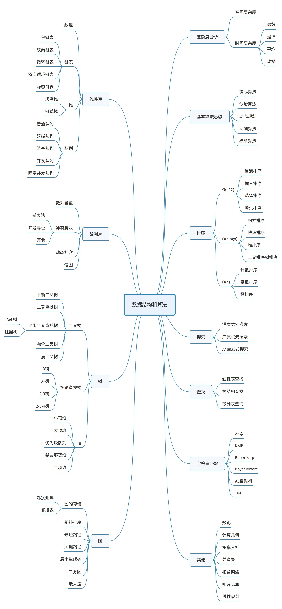

## 1. 先建立解题顺序

本篇适合已经会写 `JavaScript` 循环、但尚未形成算法解题习惯的读者。先掌握复杂度、线性结构和边界检查，再进入[查找](./算法之查找.md)与[排序](./排序算法.md)。

每道题按以下顺序推进：明确输入与输出 → 手推小例子 → 写朴素解法 → 找主要成本 → 优化 → 验证边界。复杂度分析应解释实现的成本，而不是给代码贴一个记忆中的标签。



## 2. 时间复杂度：数据变多，工作增长多快

### 2.1 从操作次数开始

设输入规模为 `n`。统计随规模增长的主要操作次数，例如扫描 `n` 个元素需要约 `n` 次访问。常数系数和低阶项在渐进分析中通常被省略：`3n + 2` 属于 `O(n)`，`n² + n` 属于 `O(n²)`。

`O(f(n))` 描述渐进上界，不表示准确运行秒数，也不必然表示紧确增长阶。这里默认比较同一种基本操作，讨论足够大的输入；小输入下常数成本也可能影响实际速度。

| 结构 | 操作次数 | 常用上界 |
| --- | --- | --- |
| 固定数量的赋值和比较 | 不随输入长度增长 | `O(1)` |
| 每轮将候选范围减半 | 约 `log₂ n` 轮 | `O(log n)` |
| 扫描全部元素一次 | 约 `n` 次 | `O(n)` |
| 归并排序的分层处理 | 约 `log n` 层，每层线性处理 | `O(n log n)` |
| 每个元素与所有元素配对 | 约 `n²` 次 | `O(n²)` |
| 枚举所有子集 | `2ⁿ` 个候选集合 | 候选数量指数增长，输出复制还要额外计费 |

线性对数阶是 `O(n log n)`，不要与对数阶 `O(log n)` 混淆。固定且大于 `1` 的对数底只相差常数因子。

### 2.2 连续执行与嵌套执行

**连续执行先相加。** 两个独立数组的长度分别为 `m` 和 `n`，各扫描一次是 `O(m + n)`；没有说明它们的关系时，不能随意删掉一个变量。

```js
function sumTwoArrays(a, b) {
    let sum = 0;
    for (const value of a) sum += value;
    for (const value of b) sum += value;
    return sum;
}
```

**嵌套循环要看每一层实际执行多少次。** 下面的内层次数取决于外层下标，总次数为 `0 + 1 + … + (n - 1)`，即 `n(n - 1) / 2`，时间为 `O(n²)`。

```js
function countPairs(n) {
    let count = 0;
    for (let i = 0; i < n; i++) {
        for (let j = 0; j < i; j++) {
            count++;
        }
    }
    return count;
}
```

本例约定 `n` 为非负整数。不要看到两层循环就直接判断平方阶：如果内层指针在整个算法中只向前移动、不重新归零，就需要统计它的总移动次数。

### 2.3 最好、最坏、平均与均摊

顺序查找中，第一个元素就是目标时，只需一次比较；目标不存在时要检查所有元素。最好情况为 `O(1)`，最坏情况为 `O(n)`。

平均情况需要声明输入的概率分布。例如假设目标一定存在，且出现在每个位置的概率相同，平均比较次数才是 `(n + 1) / 2`。如果允许不存在，必须把不存在的概率与成本也算进去。

均摊分析关注一串操作的总成本。例如动态数组采用容量倍增策略时，某次扩容需要复制多个元素，但连续追加的总成本可以是线性的，所以一次追加的均摊成本为常数。这是特定扩容策略的分析，不是对所有语言实现的性能承诺。

## 3. 空间复杂度：同时占用了多少额外空间

本系列默认说明**辅助空间**，即不包含输入本身的额外存储；返回结果占用很大时会单独注明。

- 几个变量：`O(1)`。
- 长度随输入增长的辅助数组：`O(n)`。
- `m` 行、`n` 列的表：`O(mn)`，只有两个维度都为 `n` 时才是 `O(n²)`。
- 深度为 `h` 的递归调用：通常需要 `O(h)` 调用栈，不能因为没写辅助数组就说空间为常数。

统计的是峰值同时存活的空间，不是所有历史分配的简单相加。原地修改输入也不等于完全不使用内存；常数个临时变量通常允许。

## 4. 数据结构：根据操作选择存储方式

### 4.1 数组与顺序表

线性表是有顺序的元素序列。顺序表通常以连续存储表达这种顺序，支持按下标快速定位；按值查找则不自动具有这个优势。

| 操作 | 常见数组模型下的成本 | 条件 |
| --- | --- | --- |
| 按下标读取 | `O(1)` | 下标有效 |
| 在无序数组中按值查找 | `O(n)` | 最坏情况扫描全部元素 |
| 在中间插入或删除 | `O(n)` | 后续元素通常需要移动 |
| 末尾追加 | 常见动态数组模型下均摊 `O(1)` | 取决于扩容策略 |

`JavaScript` 的 `Array` 是语言提供的对象，不应把它的所有行为等同于教科书的连续整数数组。算法练习中采用上述常用成本模型，同时要计算 `slice`、展开复制、头部插入删除等操作的成本。

### 4.2 链表：修改连接之前，先确认位置

单链表节点保存数据和后继引用，例如 `{ val: 3, next: null }`。普通空链表的头引用可以为 `null`；带哨兵头节点的实现则可以始终保留一个不存放业务元素的节点。两种约定不能混用。

- 按下标或按值寻找节点：通常为 `O(n)`。
- 已知前驱节点时，在其后插入或删除节点：连接修改为 `O(1)`。
- 只给目标值、需要先查位置时：总成本仍可能是 `O(n)`。
- 节点需要额外保存引用，也受可用内存限制，不是无限容量。

反转链表时，先画出旧后继、当前节点和新前驱，再更新引用。修改 `next` 之前必须保留后续还需要访问的节点。

扩展概念先知道用途即可：静态链表用数组下标模拟连接；循环链表让尾部连接回起点；双向链表同时保存前驱与后继。等普通链表练习稳定后再深入实现。

### 4.3 栈与队列：限制访问顺序

| 结构 | 取出顺序 | 常见用途 |
| --- | --- | --- |
| 栈 | 后进先出，`LIFO` | 括号匹配、递归调用、深度优先遍历 |
| 队列 | 先进先出，`FIFO` | 层序遍历、广度优先遍历 |

数组末尾的 `push` 和 `pop` 可表达栈。队列在算法示例中可使用数组加读取下标，避免每次删除首元素带来的移动成本；这种简化实现会保留已读元素的引用，空间分析必须按整个数组计算。长期运行的队列再考虑释放引用或使用循环缓冲区。

## 5. 验证一个解法

写代码前明确契约：空输入返回什么，元素类型是什么，能否修改输入，有无重复，返回值是否唯一。这里的数值例子假定有限数值输入；真实应用在输入边界另行做类型与范围校验。

至少选用与题目有关的边界：

1. 空输入和单元素。
2. 全负数、全相等、重复答案。
3. 答案在首尾，或答案不存在。
4. 原地修改是否符合要求，原顺序是否需要保留。

检查结果之外还要解释**循环不变量**：每轮循环前后都成立的事实。例如扫描到某个位置时，当前最大值应该是已处理元素中的最大值。这个说明可以帮助检查初始化、更新步骤与结束结果。

## 6. 练习与下一步

先完成学习工作区的第一天最大值扫描，不看答案再解释负数输入。然后做以下两个分析题：

- 给 `countPairs` 传入 `0`、`1`、`4`，手算结果并运行核对；能否写出无需嵌套循环的计算方式？
- 两个循环分别扫描长度为 `m` 与 `n` 的数组，为什么不一定能写成 `O(n)`？

能自己回答后进入[顺序查找与二分查找](./算法之查找.md)。完整阶段安排见[算法学习路线](./算法学习路线.md)。
