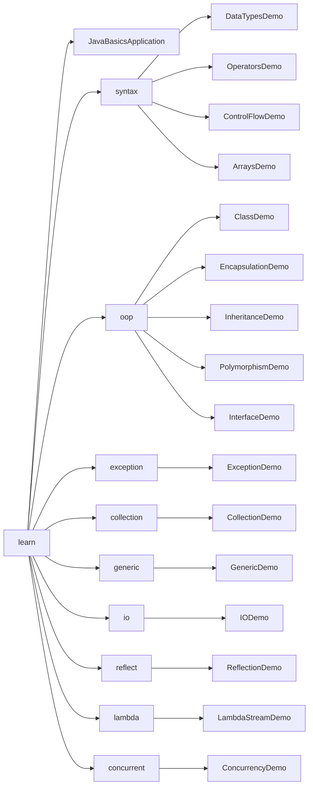
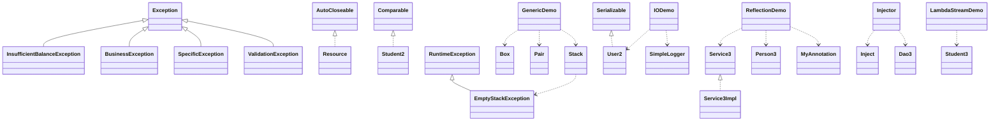
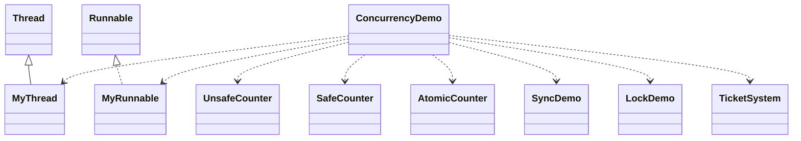

# Java Basics Code Graph

本文件用 Mermaid 描述 `java-basics` 项目的代码结构。项目是一个 Java 21 Maven 学习示例，入口类通过菜单调用各章节 Demo，每个 Demo 文件内部包含若干用于讲解的包级类、接口或注解。

## 入口与章节调用图

```mermaid
flowchart TD
    App[learn.JavaBasicsApplication]

    App --> Syntax[learn.syntax]
    App --> OOP[learn.oop]
    App --> Exception[learn.exception]
    App --> Collection[learn.collection]
    App --> Generic[learn.generic]
    App --> IO[learn.io]
    App --> Reflect[learn.reflect]
    App --> Lambda[learn.lambda]
    App --> Concurrent[learn.concurrent]

    Syntax --> DataTypesDemo
    Syntax --> OperatorsDemo
    Syntax --> ControlFlowDemo
    Syntax --> ArraysDemo

    OOP --> ClassDemo
    OOP --> EncapsulationDemo
    OOP --> InheritanceDemo
    OOP --> PolymorphismDemo
    OOP --> InterfaceDemo

    Exception --> ExceptionDemo
    Collection --> CollectionDemo
    Generic --> GenericDemo
    IO --> IODemo
    Reflect --> ReflectionDemo
    Lambda --> LambdaStreamDemo
    Concurrent --> ConcurrencyDemo
```

## 包结构图

## OOP 继承与接口关系

```mermaid
classDiagram
    Animal <|-- Dog
    Animal <|-- Cat
    Dog <|-- Puppy

    StudentInherit <|-- GraduateStudent
    Parent <|-- Child
    Shape <|-- Circle
    Shape <|-- Rectangle

    AnimalPoly <|-- DogPoly
    AnimalPoly <|-- CatPoly
    AnimalPoly <|-- BirdPoly
    Payment <|.. Alipay
    Payment <|.. WeChatPay
    Payment <|.. UnionPay
    PaymentService ..> Payment
    Parent2 <|-- Child2
    Shape2 <|-- Circle2
    Shape2 <|-- Rectangle2
    Shape2 <|-- Triangle2

    Flyable <|.. Airplane
    Flyable <|.. Bird2
    Flyable <|.. Duck2
    Swimmable <|.. Duck2
    AnimalInterface <|.. Duck2
    Phone <|.. Smartphone
    Vehicle <|-- ElectricVehicle
    Electric <|-- ElectricVehicle
    ElectricVehicle <|.. ElectricCar
    UserService <|.. UserServiceImpl
    Comparable <|.. StudentIF

    class ClassDemo
    class Person
    class Calculator
    class AccessDemo
    class LomPerson
    class OuterClass

    class EncapsulationDemo
    class UnencapsulatedUser
    class User
    class BankAccount
    class AccessControlDemo
    class PasswordManager
```

## 核心特性 Demo 内部关系

## 并发 Demo 关系

## 文件到主题索引

| 文件 | 主题 |
| --- | --- |
| `src/main/java/learn/JavaBasicsApplication.java` | 菜单入口，按选项调用各 Demo 的 `main` 方法 |
| `src/main/java/learn/syntax/*.java` | 数据类型、运算符、流程控制、数组 |
| `src/main/java/learn/oop/*.java` | 类、封装、继承、多态、接口 |
| `src/main/java/learn/exception/ExceptionDemo.java` | 异常处理、自定义异常、try-with-resources |
| `src/main/java/learn/collection/CollectionDemo.java` | List、Set、Map、Comparable |
| `src/main/java/learn/generic/GenericDemo.java` | 泛型类、泛型方法、通配符、类型边界 |
| `src/main/java/learn/io/IODemo.java` | 字节流、字符流、NIO、序列化、简单日志 |
| `src/main/java/learn/reflect/ReflectionDemo.java` | 反射、注解、简易依赖注入 |
| `src/main/java/learn/lambda/LambdaStreamDemo.java` | Lambda、Stream、Optional、函数式风格 |
| `src/main/java/learn/concurrent/ConcurrencyDemo.java` | Thread、Runnable、锁、原子类、线程池、CompletableFuture |

