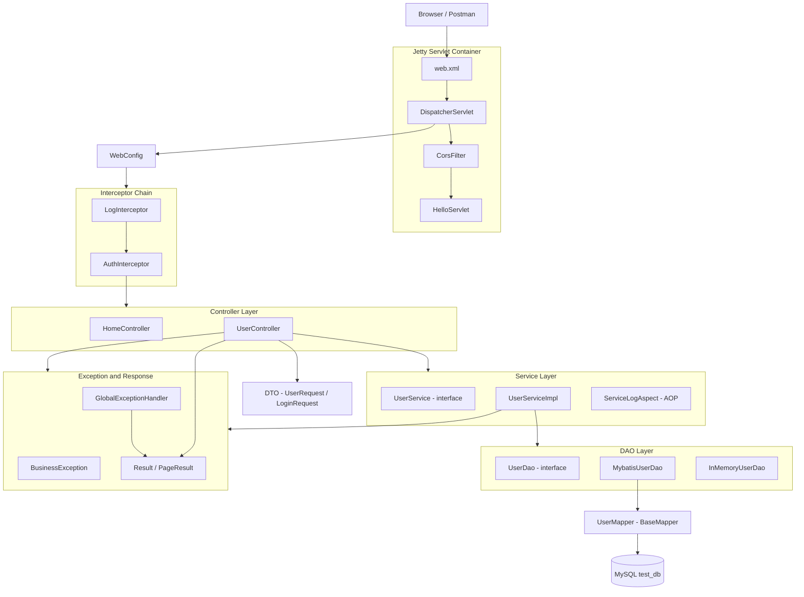
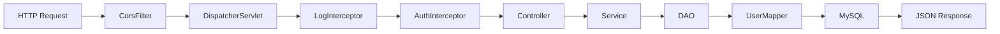
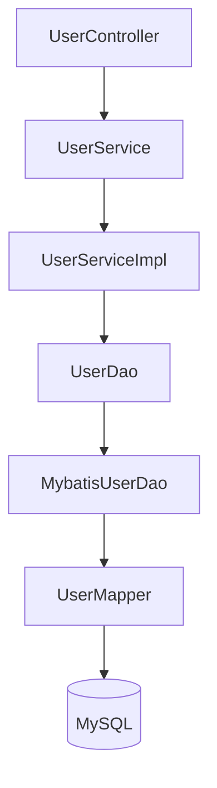
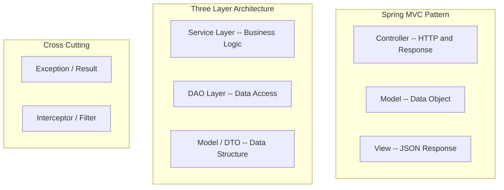
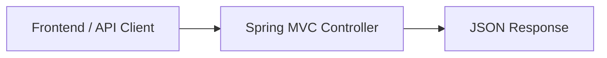

# Spring MVC 架构说明

本文档说明 `src/main/java/com/example/stage3` 目录下的 Spring MVC 架构划分，以及一次 HTTP 请求在本项目中的完整流转过程。

## 架构图



## 请求流转

一次完整的 HTTP 请求链路：



核心入口是 `src/main/webapp/WEB-INF/web.xml`。该文件把 `/` 路径下的请求交给 Spring MVC 的 `DispatcherServlet` 处理。

核心配置是 `src/main/java/com/example/stage3/config/WebConfig.java`。该类通过以下注解和配置组织整个 Web 应用：

```java
@EnableWebMvc
@ComponentScan("com.example.stage3")
@MapperScan("com.example.stage3.dao.mapper")
```

其中：

- `@EnableWebMvc`：启用 Spring MVC。
- `@ComponentScan`：扫描 `Controller`、`Service`、`Repository`、`Aspect` 等 Spring Bean。
- `@MapperScan`：扫描 MyBatis-Plus 的 Mapper 接口。
- `addInterceptors`：注册日志拦截器和认证拦截器。
- `configureMessageConverters`：配置 JSON 序列化。
- `getValidator`：启用 Bean Validation 参数校验。
- `addCorsMappings`：配置跨域访问。

## 项目分层

| 包 | 作用 | 职责 |
|---|---|---|
| `config` | Spring MVC 核心配置 | 启用 MVC、扫描 Bean、注册拦截器、配置 JSON、校验、MyBatis |
| `controller` | Controller 层 | 接收 HTTP 请求，解析参数，调用 Service，返回 JSON |
| `service` / `service.impl` | Service 层 | 处理业务逻辑，如注册、登录、分页、更新、删除 |
| `dao` | DAO 数据访问抽象 | 定义数据访问接口，屏蔽底层实现 |
| `dao.mapper` | MyBatis-Plus Mapper | 直接操作数据库表 |
| `model` | Model / Entity | 数据库实体对象，如 `User` |
| `dto` | 请求参数对象 | 接收前端传来的 JSON 参数 |
| `support` | 通用支持类 | 统一返回结构、分页结果、AOP 日志 |
| `interceptor` | Spring MVC 拦截器 | 请求进入 Controller 前做日志、认证 |
| `exception` | 全局异常处理 | 把异常统一转换成 JSON 响应 |
| `filter` | Servlet Filter | 比 Spring MVC 拦截器更靠前的 Web 层过滤 |
| `servlet` | 原生 Servlet 示例 | 用于教学对比，不是核心 Spring MVC 业务链路 |

## 用户模块调用链

以用户相关接口为例，典型调用链如下：



对应职责如下：

- `UserController`：暴露 `/api/users` 下的 REST 接口，负责接收请求参数、触发校验、调用业务层并返回统一结果。
- `UserService`：定义用户业务接口。
- `UserServiceImpl`：实现用户业务逻辑，包括注册、登录、分页查询、按 ID 查询、更新和删除。
- `UserDao`：定义数据访问接口，使 Service 层不依赖具体数据库实现。
- `MybatisUserDao`：基于 MyBatis-Plus 实现 `UserDao`。
- `UserMapper`：继承 MyBatis-Plus 的 `BaseMapper`，获得基础 CRUD 能力。
- `User`：用户实体，对应数据库中的用户数据。

## MVC 与三层架构的关系

本项目实际采用的是 Spring MVC + 三层架构的组合：



这里的 MVC 主要体现在：

- `Controller`：由 `UserController`、`HomeController` 承担。
- `Model`：由 `User`、`UserRequest`、`LoginRequest`、`Result`、`PageResult` 等数据对象承担。
- `View`：本项目主要是 REST API 风格，没有传统 JSP 页面视图，响应结果主要是 JSON。

因此，这个项目不是传统的 `Controller -> JSP View` 模式，而是更常见的前后端分离 REST API 模式：



## 关键设计点

1. Controller 不直接访问数据库，而是通过 Service 调用业务逻辑。
2. Service 不直接依赖 MyBatis-Plus Mapper，而是依赖 `UserDao` 抽象。
3. DAO 层可以切换实现，例如 `MybatisUserDao` 或 `InMemoryUserDao`。
4. 统一使用 `Result` 和 `PageResult` 包装响应，避免接口返回结构不一致。
5. 统一使用 `GlobalExceptionHandler` 捕获异常并转换为 JSON。
6. 使用 `AuthInterceptor` 对 `/api/users/**` 中除登录和注册外的接口做认证拦截。
7. 使用 `LogInterceptor` 和 `ServiceLogAspect` 做请求和业务方法日志。
